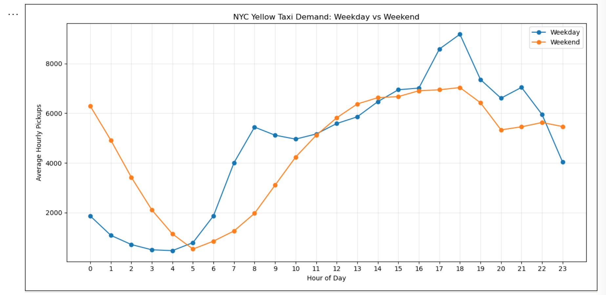
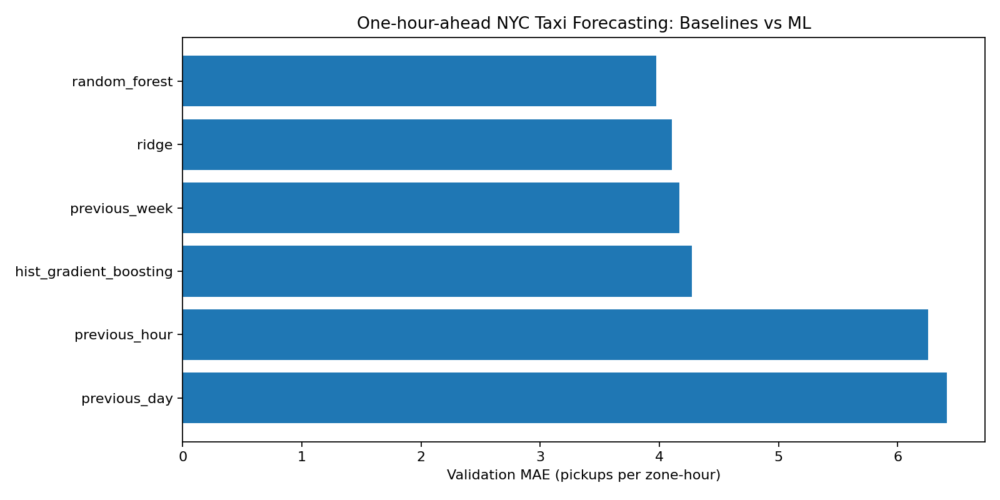
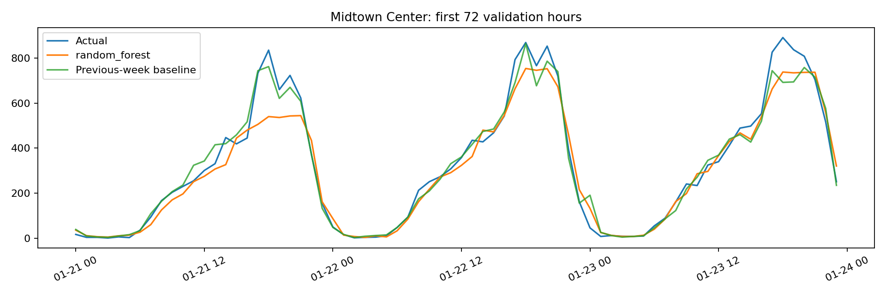

# Urban Mobility Intelligence: NYC Taxi Demand Forecasting

### Turning raw taxi journeys into practical insights and hourly demand forecasts

**Python | Microsoft Fabric | PySpark | Delta Lake | DuckDB | Scikit-learn | SQL | Data Visualisation**

[Explore the Notebooks](notebooks/) | [View the Results](results/local_run/) | [Read the Final Report](reports/EXECUTED_REPORT.md) | [Project Methodology](docs/methodology.md)

---

## 1. Project Overview

Can historical taxi trips help us understand where and when New York City is likely to need more taxis?

This question inspired me to develop **Urban Mobility Intelligence**, an end-to-end data engineering and machine learning project using New York City's publicly available Yellow Taxi trip records.

I wanted to go beyond simply training a machine learning model on an already cleaned dataset. My goal was to experience the entire data science process, from understanding raw data and addressing quality issues to building forecasting models and evaluating their performance.

The project began in Microsoft Fabric, where I developed a Bronze–Silver–Gold Lakehouse architecture using PySpark and Delta Lake.

When I encountered problems accessing my Fabric environment, I adapted the project to run locally using Python, DuckDB and Scikit-learn.

This experience reinforced an important lesson: a good data science solution should be reproducible, adaptable and understandable, regardless of the technology platform.

---

## 2. The Business Problem

Taxi demand changes throughout the day and across different parts of a city.

Some neighbourhoods experience consistently high pickup activity, while others have relatively little recorded Yellow Taxi usage.

Understanding these variations could help inform:

- Taxi fleet positioning and resource allocation.
- Identification of peak travel periods.
- Short-term demand planning.
- Analysis of geographic differences in taxi activity.
- Data-driven transport planning decisions.

**Project objective:** Develop a forecasting approach that predicts the number of recorded Yellow Taxi pickups in each NYC taxi zone for the next hour.

The project focuses on recorded Yellow Taxi pickups rather than total passenger demand. It is an analytical case study, not a live taxi dispatch system.

---

## 3. Dataset

I used the official **New York City Taxi and Limousine Commission (TLC)** Yellow Taxi trip records for January 2025.

The dataset contains approximately 3.48 million trip records, including pickup and drop-off timestamps, pickup locations, trip distances and other trip-related information.

I also used the official taxi-zone lookup file to identify pickup zones and boroughs.

**Data sources:**

- [NYC TLC Trip Record Data](https://www.nyc.gov/site/tlc/about/tlc-trip-record-data.page)
- [January 2025 Yellow Taxi Data](https://d37ci6vzurychx.cloudfront.net/trip-data/yellow_tripdata_2025-01.parquet)
- [Taxi Zone Lookup](https://d37ci6vzurychx.cloudfront.net/misc/taxi_zone_lookup.csv)

### Dataset Summary

| Measurement | Result |
|---|---:|
| Original trip records | 3,475,226 |
| Eligible January NYC pickups | 3,465,683 |
| Observed pickup zones | 259 |
| Complete zone-hour observations | 192,696 |
| Zero-pickup zone-hours | 96,942 |
| Model-ready observations | 149,184 |

---

## 4. Technologies Used

| Technology | Purpose |
|---|---|
| Microsoft Fabric | Initial cloud data engineering environment |
| PySpark | Large-scale data processing and transformation |
| Delta Lake | Structured analytical data storage |
| SQL | Data querying and aggregation |
| Python | Data processing, analysis and modelling |
| DuckDB | Local analytical database |
| Pandas | Data manipulation and analysis |
| Matplotlib | Data visualisation |
| Scikit-learn | Machine learning and model evaluation |
| Git and GitHub | Version control and project documentation |

---

## 5. Project Architecture

I followed a **Medallion Architecture**, organising data into Bronze, Silver and Gold layers.

```text
NYC TLC Yellow Taxi Dataset
            |
            v
      BRONZE LAYER
    Raw Data Exploration
            |
            v
      SILVER LAYER
   Data Quality Checks
   Geographic Enrichment
   Eligibility Classification
            |
            v
       GOLD LAYER
    Hourly Taxi Demand
    Zone-Level Aggregation
    Complete Hourly Grid
            |
            v
 EXPLORATORY DATA ANALYSIS
    Temporal Patterns
    Geographic Differences
    Demand Sparsity
            |
            v
    FEATURE ENGINEERING
    Calendar Features
    Historical Lag Features
    Rolling Averages
            |
            v
      MACHINE LEARNING
    Baseline Forecasting
    Regression Models
    Model Comparison
            |
            v
    PERFORMANCE EVALUATION
    MAE and RMSE
    Demand Category Analysis
    Forecast Visualisation
```

### Bronze Layer — Understanding the Raw Data

I began by exploring the original taxi trip dataset.

This included examining the schema, identifying missing values, checking timestamp ranges and investigating unusual trip distances and durations.

Rather than immediately removing questionable observations, I explored how these issues could affect the final forecasting problem.

### Silver Layer — Data Transformation

The Silver layer focused on improving data usability while preserving information about data quality.

I implemented checks for:

- Unknown or out-of-area pickup locations.
- Pickup timestamps outside January 2025.
- Zero, negative or extreme trip distances.
- Invalid or unusually long trip durations.
- Pickup eligibility for the forecasting analysis.

I also enriched the trip records with taxi-zone and borough information.

The resulting Silver dataset preserved all **3,475,226 original records**, with quality flags identifying which observations were suitable for the pickup-demand analysis.

### Gold Layer — Hourly Demand Aggregation

In the Gold layer, I transformed individual taxi trips into hourly pickup counts for each taxi zone.

A complete hourly calendar was generated for January 2025 and combined with the observed pickup zones.

This produced **192,696 zone-hour observations**, covering 259 zones and 744 hours.

Missing combinations were assigned zero recorded pickups under an explicit source-completeness assumption.

This created a consistent time-series structure for exploratory analysis and forecasting.

---

## 6. Exploratory Data Analysis

One of the most interesting parts of this project was discovering how differently taxi demand behaves across time and location.

### 6.1 Hourly Taxi Demand

The highest recorded pickup activity occurred at **18:00**, while the lowest occurred at **04:00**.

This suggested that time of day could be an important predictor in the forecasting models.

### 6.2 Weekday vs Weekend Patterns

Weekday and weekend demand followed noticeably different patterns.

Weekdays showed a strong morning increase, while weekends had significantly more activity during late-night hours.

Both day types reached their highest average pickup volume at 18:00.

These patterns suggest that calendar features should be considered together rather than independently.



### 6.3 Geographic Demand

Taxi demand was concentrated in a relatively small number of zones.

Midtown Center, the Upper East Side, Times Square and JFK Airport were among the busiest pickup locations.

Of the 259 observed zones, only **34 were classified as high demand**, but they accounted for approximately **83.8% of all eligible pickups**.

This highlighted the importance of evaluating forecasting performance across different geographic demand levels.

### 6.4 Demand Sparsity

Approximately **50.3% of the complete zone-hour dataset contained zero recorded pickups**.

Additionally, 145 zones had zero recorded pickups during more than half of the observed hours.

This presented an interesting modelling challenge: a forecasting model might perform well in busy areas while struggling to predict activity in zones with very few pickups.

---

## 7. Feature Engineering

After completing exploratory analysis, I developed features to help machine learning models understand historical demand patterns.

### Calendar Features

- Hour of day
- Day of week
- Day of month
- Month
- Weekend indicator

### Historical Demand Features

- Previous-hour pickups (`lag_1`)
- Two-hour lag (`lag_2`)
- Previous-day pickups (`lag_24`)
- Previous-week pickups (`lag_168`)

### Rolling Average Features

- Previous three-hour average demand
- Previous 24-hour average demand

The rolling averages were calculated using only earlier observations to avoid including the target hour's actual pickup count.

After accounting for the historical data required by the previous-week lag, the final modelling dataset contained **149,184 observations**.

---

## 8. Forecasting Approach

Before developing advanced machine learning models, I evaluated three simple forecasting baselines.

These methods predicted hourly demand using:

1. The previous hour's recorded pickups.
2. The same hour on the previous day.
3. The same hour in the previous week.

The dataset was divided chronologically to reflect how forecasting works in practice.

| Dataset | Period | Observations |
|---|---|---:|
| Training | 8–20 January 2025 | 80,808 |
| Validation | 21–25 January 2025 | 31,080 |
| Retrospective testing | 26–31 January 2025 | 37,296 |

### Baseline Forecasting Results

| Forecasting Method | Validation MAE |
|---|---:|
| Previous hour | 6.2557 |
| Previous day | 6.4114 |
| **Previous week** | **4.1659** |

The previous-week baseline achieved the lowest validation Mean Absolute Error.

This indicated that weekly patterns were particularly useful for predicting recorded Yellow Taxi pickups.

The baseline reduced MAE by approximately **33.4% compared with the previous-hour method**.

These results provided a meaningful benchmark for subsequent machine learning experiments.

---

## 9. Machine Learning Models

I extended the project by developing a local machine learning workflow using Scikit-learn.

The implemented regression models include:

- Ridge Regression
- Random Forest Regression
- Histogram-based Gradient Boosting Regression

These models use calendar information, previous pickup counts and historical rolling averages to predict hourly demand.

The local workflow trains candidate models, evaluates their validation performance and generates prediction files, comparison charts and evaluation reports.

### Model Evaluation

Models are evaluated using:

- Mean Absolute Error (MAE)
- Root Mean Squared Error (RMSE)
- Performance across different demand categories
- Comparisons with historical forecasting baselines
- Visual inspection of predicted versus actual pickup counts

Model selection is based on the validation period.

The final period is described as a retrospective test because baseline results from those dates were inspected during development.

For the actual executed machine learning results, see:

- [Executed Model Report](reports/EXECUTED_REPORT.md)
- [Validation Model Comparison](reports/validation_model_comparison.csv)
- [Category-Level Evaluation](reports/validation_category_metrics.csv)
- [Machine-Readable Metrics](results/local_run/metrics.json)

The detailed results are maintained in these generated files so that the README remains consistent with the executed experiments.

### Model Comparison Visualisation



### Midtown Center Forecasting Example



---

## 10. Repository Structure

```text
fabric-nyc-taxi-demand-forecasting/
|
|-- notebooks/
|   |-- Data exploration
|   |-- Silver transformations
|   |-- Gold hourly aggregation
|   |-- Exploratory analysis
|   |-- Feature engineering
|   |-- Baseline forecasting
|   |-- Machine learning
|   |-- Model evaluation
|
|-- data/
|   |-- Raw and reference data locations
|
|-- src/
|   |-- Reusable Python source code
|
|-- scripts/
|   |-- Data download and local execution
|
|-- results/
|   |-- local_run/
|   |   |-- metrics.json
|   |   |-- Model predictions
|   |   |-- Trained model
|   |   |-- DuckDB database
|   |   |-- Generated charts
|
|-- reports/
|   |-- EXECUTED_REPORT.md
|   |-- final-project-report.md
|   |-- Model comparison charts
|   |-- Evaluation tables
|
|-- docs/
|   |-- Project architecture
|   |-- Methodology
|   |-- Findings and limitations
|
|-- assets/
|-- tests/
|-- requirements-local.txt
|-- requirements-fabric.txt
|-- README.md
```

---

## 11. Running the Project Locally

The original data engineering workflow was developed in Microsoft Fabric.

I subsequently created a local Python implementation to reproduce the processing and machine learning workflow without requiring Fabric access.

### Clone the Repository

```bash
git clone https://github.com/mnsamararathne/fabric-nyc-taxi-demand-forecasting.git

cd fabric-nyc-taxi-demand-forecasting
```

### Create a Python Virtual Environment

```bash
python3 -m venv .venv

source .venv/bin/activate
```

### Install Dependencies

```bash
pip install -r requirements-local.txt
```

### Download the Dataset

```bash
python scripts/download_data.py
```

### Run the Local Pipeline

```bash
python scripts/run_local.py
```

The pipeline downloads the required source data, processes the trip records, prepares forecasting features, trains models and generates evaluation outputs.

Generated outputs are saved under `results/local_run/`.

The large DuckDB database and trained model are tracked using Git LFS.

---

## 12. Challenges and Lessons Learned

This project taught me that building a forecasting model involves much more than selecting an algorithm.

One challenge was dealing with unusual records and deciding which trips should contribute to the demand analysis. I learned that retaining data-quality information can be more useful than simply deleting suspicious observations.

Another important challenge was creating a complete hourly time series. Without explicitly handling zone-hour combinations with no recorded pickups, the dataset would have been unsuitable for consistent hourly forecasting.

I also developed a better understanding of data leakage, particularly when creating historical lag features and rolling averages.

Perhaps the most practical challenge was losing access to my original Microsoft Fabric environment. Instead of abandoning the project, I adapted the implementation to work locally.

This helped me understand the importance of reproducible code, version control and designing workflows that are not entirely dependent on one technology platform.

---

## 13. Limitations and Future Improvements

Although the project provides a complete forecasting workflow, there are opportunities to improve its analytical depth.

The current analysis is limited to January 2025, meaning longer-term seasonal patterns cannot be reliably evaluated.

Other limitations include:

- No weather or major event information.
- Different levels of pickup activity between taxi zones.
- High proportions of zero recorded pickups.
- The assumption that absent zone-hour records represent zero recorded pickups.
- Limited historical coverage for evaluating forecast stability.

Future improvements could include adding several months of data, weather conditions, public holidays and special events.

I would also like to investigate rolling-origin backtesting, alternative forecasting algorithms and approaches specifically designed for low-demand zones.

---

## 14. Final Reflection

What I found most valuable about this project was seeing how data engineering, exploratory analysis and machine learning connect to solve one problem.

Starting with millions of individual taxi journeys, I developed a structured analytical dataset, explored patterns in time and geography, engineered historical features and built a reproducible forecasting workflow.

The experience strengthened my understanding of Python, PySpark, SQL, data engineering, time-series analysis and machine learning evaluation.

More importantly, it helped me develop a more practical approach to data science: understanding the problem first, questioning assumptions, validating each transformation and making sure that results can be explained clearly.

---

## Project Information

**Project:** Urban Mobility Intelligence — NYC Taxi Demand Forecasting

**Area:** Data Science, Data Engineering, Time-Series Forecasting

**Data Source:** New York City Taxi and Limousine Commission

**Repository:** [GitHub — NYC Taxi Demand Forecasting](https://github.com/mnsamararathne/fabric-nyc-taxi-demand-forecasting)

*Developed as a practical Data Science and Business Analytics portfolio project using publicly available NYC Taxi data.*
